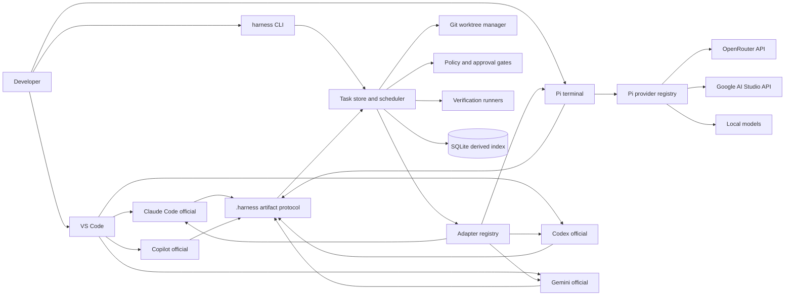
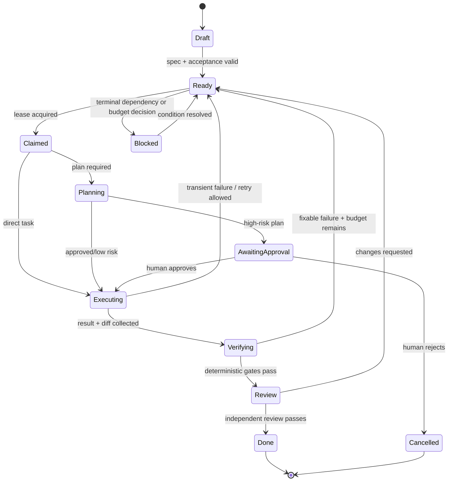

# Omni Harness: Architecture and Logic Design

Status: proposed architecture, ready for an MVP implementation  
Date: 2026-07-18  
Scope: full-stack software, infrastructure, automation, firmware, and hardware-assisted development

## 1. Executive decision

Build a **federated harness**, not a universal model proxy.

Use **Pi as the primary interactive, programmable harness** for API, OpenRouter, Google AI Studio, and local models. Use the official Claude Code, Codex, Gemini, and Copilot clients when consuming flat-rate subscription allowances. Coordinate all of them with a small custom **Deno control plane** and a versioned, typed artifact store inside each project.

The control plane owns tasks, context manifests, leases, policy, budgets, events, and verification. It does not pretend that every vendor login is a portable API credential. This distinction makes the design reliable, auditable, and compliant with provider boundaries.

The recommended stack is:

| Concern | Choice | Why |
|---|---|---|
| Primary terminal harness | Pi | Extensible TypeScript runtime, provider switching, custom tools, hooks, handoffs, and remote execution |
| IDE | VS Code | Best common workspace, diagnostics, source control, and official vendor extensions |
| Subscription executors | Official Claude Code, Codex, Gemini CLI/extension, Copilot | Preserve each product's native entitlement and capabilities |
| API/model routing | Pi provider registry initially; optional LiteLLM later | Avoid premature infrastructure and keep routing observable |
| Orchestration/control plane | Custom Deno CLI and daemon | Single-binary TypeScript, safe subprocess APIs, schemas, tests, and cross-platform distribution |
| Shared project state | `.harness/` files + SQLite index | Git-reviewable truth plus fast derived queries |
| Isolation | Git worktrees + task leases | Prevent concurrent writers from corrupting the same workspace |
| Configuration distribution | Fork/adapt `adrielp/ai-engineering-harness` | Useful installer and prompt/skill library, but not a runtime orchestrator |
| Optional background execution | systemd user service / container | Only after the interactive MVP is stable |

This is intentionally a **single control plane with multiple execution planes**, not a “single brain.” Models do not need to share chat history. They need to share clean task specifications, evidence, decisions, and outputs.

## 2. What is retained and what is corrected from the brainstorm

### Retain

- A text-artifact memory bus readable by every client.
- Separation of planning, implementation, and independent verification.
- Context minimization through manifests, search, bounded outputs, and progressive disclosure.
- Different models for different task classes.
- Isolated work zones for concurrent agents.
- Cheap models for bounded mechanical work, summarization, and classification.
- Human approval for dangerous infrastructure and hardware actions.

### Correct

- `INBOX.md` cannot be the queue. Multiple writers, partial edits, and ambiguous ownership make it unsafe. Use one immutable task directory per task.
- `STATE.md` cannot be the canonical state. It is a generated human-readable view; structured task metadata and an append-only event log are canonical.
- Do not route consumer OAuth tokens through a home-made proxy. Anthropic explicitly reserves subscription OAuth for native applications and directs third-party products to API authentication ([Claude Code legal and compliance](https://code.claude.com/docs/en/legal-and-compliance)). Other providers may impose different or changing boundaries.
- Do not route by brand folklore (“Claude always architects,” “Gemini only reads”). Route by measured capability, availability, data policy, tool requirement, and task risk.
- Do not auto-rotate accounts or evade provider limits. Fail over across authorized providers and explicit budgets only.
- Do not summarize every commit with an LLM. Git is already the authoritative change record. Generate a task summary only at handoff or close.
- Do not begin with Redis, a Docker “God Proxy,” dozens of MCP servers, or a swarm. They add failure modes before the task protocol is proven.
- Treat unverified package names and performance claims in earlier notes as hypotheses, not dependencies.

## 3. Architectural principles

1. **Artifacts over conversations.** Persist specifications, decisions, evidence, patches, and verification—not entire vendor transcripts.
2. **One task, one owner, one writable worktree.** Parallelism occurs between independent task scopes.
3. **Route before prompting.** Select an execution surface using policy; do not ask an agent to decide which paid product the human should open next.
4. **Deterministic gates beat model confidence.** Tests, type checks, ERC/DRC, linters, and policy checks decide whether work advances.
5. **Derived memory is disposable.** SQLite/FTS indexes and summaries may be rebuilt from repository artifacts.
6. **Subscriptions are execution surfaces, not fungible API capacity.** A subscription executor may be launched or used through its supported client; an API executor is called programmatically.
7. **Least privilege by phase.** A planner is read-only; an implementer writes only its worktree; a verifier should not repair its own submission by default.
8. **No invisible failover for high-risk tasks.** A provider/model change that affects privacy, price, or capability is recorded and, where necessary, approved.

## 4. System context



Copilot is deliberately outside autonomous orchestration in the first version. It is a low-friction interactive editor feature, not a required backend. Cloud/vendor agents may also be outside direct process control; the protocol supports a manual pickup/drop-off adapter without weakening the task model.

## 5. Component design

### 5.1 Deno control plane: `harness`

The Deno application is a local CLI first and an optional daemon later.

Commands:

```text
harness init
harness task create --title "..." --class firmware --risk high
harness task plan <id> --executor claude-code
harness task run <id> --executor pi:openrouter/...
harness task claim <id> --executor codex
harness task handoff <id> --to verifier
harness task verify <id> --profile default
harness task close <id>
harness status [<id>]
harness doctor
harness cost report
```

Internal modules:

```text
src/
  cli/                 argument parsing and user interaction
  domain/              Task, Attempt, Lease, Evidence, Decision
  store/               atomic filesystem store and SQLite projections
  scheduler/           eligibility, routing, retry, and state transitions
  adapters/            pi, claude-code, codex, gemini, manual
  context/             manifest builder, redaction, budgets, repo map
  policy/              risk classification and action authorization
  worktrees/           creation, locking, diff collection, cleanup
  verification/        test profiles and evidence normalization
  telemetry/           usage, latency, failures, provider/model scorecards
```

Run-to-completion CLI commands should be the default. A daemon is justified only for queued API jobs, remote workers, or scheduled maintenance. Deno is a good choice for the control plane, but Pi extensions should remain native TypeScript packages in Pi's supported runtime rather than forcing Deno into Pi internals.

### 5.2 Adapter contract

Every executor implements the same logical contract even if transport differs:

```ts
interface ExecutorAdapter {
  id: string;
  mode: "api" | "native-cli" | "manual";
  capabilities(): Promise<CapabilitySnapshot>;
  prepare(attempt: Attempt, context: ContextBundle): Promise<PreparedRun>;
  launch(run: PreparedRun, signal: AbortSignal): Promise<RunHandle>;
  collect(handle: RunHandle): Promise<ExecutionResult>;
  cancel(handle: RunHandle): Promise<void>;
}
```

Adapter meanings:

- **Pi adapter:** strongest programmable adapter; chooses an API/local model and loads only task-approved tools.
- **Native CLI adapter:** invokes a documented official client in the task worktree, if its supported CLI mode permits it. The vendor client retains authentication and its own safety controls.
- **Manual adapter:** creates a self-contained pickup prompt and waits for the user to return an output artifact. This is the correct fallback for browser-only or non-automatable subscription features.
- **VS Code adapter:** optional later. It exposes tasks and status in a panel; it should not duplicate scheduler logic.

No adapter reads another vendor's credential files. Credential ownership stays with the native client or OS secret store.

### 5.3 Pi shared core

Pi is the experimental execution workbench, not the global source of truth. Its shared package should contain:

- task pickup and structured completion tools;
- a policy hook that blocks disallowed shell or hardware actions;
- output reducers for searches, builds, logs, and serial traces;
- context-manifest loading;
- provider telemetry;
- a handoff command that writes artifacts rather than forwarding full transcripts;
- optional lazy discovery of large tool catalogs.

Pi officially supports TypeScript extensions, provider registration, tool interception, remote operations, truncation helpers, lazy searchable tools, and cross-provider handoff examples ([Pi extension documentation](https://pi.dev/docs/latest/extensions)). This means much of the earlier “shared core” idea is feasible without inventing undocumented packages.

### 5.4 Configuration kit

`adrielp/ai-engineering-harness` is useful as a **configuration distribution pattern**: its Deno installer copies prompts, agents, and workflows into Claude Code, OpenCode, Gemini CLI, and Pi, with dry-run and conflict handling ([project README](https://github.com/adrielp/ai-engineering-harness)). It is not, by itself, the scheduler, state machine, lease manager, router, or verifier described here.

Recommended use:

1. Fork it or borrow its manifest/installer approach.
2. Reduce its prompts to thin adapters that point to the project protocol.
3. Add Codex and Copilot instruction targets.
4. Pin releases/commit SHAs; never execute a moving remote installer in production.
5. Keep orchestration code in a separate package so configuration updates cannot mutate task state.

## 6. Project storage protocol

```text
.harness/
  config.yaml                 project policy and verification profiles
  README.md                   protocol for humans and agents
  architecture/              durable, reviewed project knowledge
    system.md
    constraints.md
    decisions/
  tasks/
    H-20260718-001/
      task.json               canonical task metadata
      spec.md                 acceptance criteria and non-goals
      context.json            exact context manifest with hashes
      lease.json              current writer lease; ephemeral/ignored
      events.jsonl            append-only lifecycle events
      attempts/
        001/
          request.md          provider-neutral execution brief
          executor.json       surface, model, policy, time, usage
          result.md           structured agent report
          patch.diff          captured diff, if applicable
          evidence/           normalized test/log/report artifacts
      review.md               independent review findings
      final.md                concise closeout and unresolved risks
  generated/
    STATUS.md                 human dashboard; never canonical
    repo-map.md               disposable structural map
  cache/                      ignored; FTS DB and large derived output
  schemas/                    vendored JSON Schemas for protocol version
```

Tool-specific entry files are short spokes:

- `AGENTS.md` → project rules and `.harness/README.md`
- `CLAUDE.md` → the same protocol, with Claude-specific invocation notes
- `.github/copilot-instructions.md` → coding rules and relevant architecture pointers
- Pi project config → task tools and project package
- Gemini context file → same canonical pointers

Do not make every agent read every architecture file at startup. The task's `context.json` names the minimum required paths and symbol/range selectors.

### 6.1 Task schema (abridged)

```json
{
  "schemaVersion": "1.0",
  "id": "H-20260718-001",
  "title": "Implement gyro register driver",
  "class": "firmware",
  "risk": "high",
  "state": "ready",
  "owner": null,
  "dependencies": [],
  "scope": {
    "read": ["src/sensors/**", ".harness/architecture/**"],
    "write": ["src/sensors/gyro.*", "tests/gyro/**"]
  },
  "acceptance": ["unit tests pass", "no writes to a physical device"],
  "verificationProfile": "firmware-safe",
  "budget": { "maxUsd": 2.0, "maxAttempts": 3, "deadlineMinutes": 45 }
}
```

### 6.2 Context manifest

Each item contains path, content hash, reason, priority, and selector. A context bundle is immutable for an attempt. If a required file changes, the attempt is stale and must be rebased or restarted.

```json
{
  "task": "H-20260718-001",
  "items": [
    {"path":"src/sensors/gyro.hpp","sha256":"...","selector":"full","reason":"target"},
    {"path":"src/i2c/bus.hpp","sha256":"...","selector":"symbols:I2cBus","reason":"dependency"},
    {"path":".harness/architecture/decisions/ADR-004.md","sha256":"...","selector":"full","reason":"constraint"}
  ]
}
```

Large PDFs, binaries, and raw logs should not be committed to chat context. Store or reference them as inputs, extract bounded evidence into an attempt, and record provenance plus hashes.

## 7. Task lifecycle and scheduler logic



Transition rules:

- State changes append an event before updating the projection.
- Lease acquisition is atomic and includes executor, PID/host, worktree, and expiry.
- A heartbeat renews long runs. Expired leases become `orphaned`; they are never silently reassigned while the process is alive.
- Only the lease holder writes to the task worktree.
- Verification commands execute from project policy, not from model-generated strings.
- Retries create a new attempt and receive the previous failure evidence, not the full conversation.
- After the configured failure count, escalate model/surface or request human action; never loop indefinitely.

### 7.1 Worktree policy

For any autonomous write task:

1. Create `.worktrees/<task-id>-<attempt>` on a dedicated branch.
2. Build the context manifest against that commit.
3. Restrict writes to task scope where the executor supports enforcement; always audit the resulting diff.
4. Reject modifications outside the allowed path set unless explicitly approved.
5. Run verification in the same worktree.
6. Present commit/diff for integration. The MVP does not auto-merge.

Interactive autocomplete and small human-led edits may operate in the main worktree, but they are not concurrently scheduled autonomous tasks.

## 8. Routing design

Routing is a constrained scoring problem, not a hard-coded provider hierarchy.

### 8.1 Required filters

An executor is eligible only if all are true:

- supports the required modality and tools;
- meets the privacy/data residency classification;
- is allowed for the task risk;
- is currently available within its supported quota/auth mode;
- fits the remaining cost and time budget;
- supports the required level of automation (or the task permits manual pickup).

### 8.2 Ranking

Among eligible executors:

```text
score =
  0.30 * measured_quality(task_class) +
  0.20 * tool_fit +
  0.15 * reliability_30d +
  0.10 * context_fit +
  0.10 * latency_fit +
  0.10 * marginal_cost_fit +
  0.05 * remaining_quota_fit
```

Weights are configurable by task class. “Measured quality” comes from accepted attempts and verification outcomes, not generic benchmarks. Start with conservative priors and accumulate local evidence.

### 8.3 Practical initial routes

| Task shape | Default surface | Alternative |
|---|---|---|
| Complex repo implementation/refactor | Codex or Claude Code official | Pi with a frontier API model |
| Architecture/specification | Claude Code or Codex, read-only | Pi with two-pass planner/reviewer |
| Huge document/log extraction | Gemini official or AI Studio API | Pi with Gemini/API model and extraction schema |
| Fast bounded scripting/data conversion | Pi with cheap model | Codex/Claude if already active |
| Inline completion | Copilot | VS Code/Pi model provider if it proves equally low-friction |
| Web-grounded research | Product with native research/search or a dedicated search tool | API model with explicit sources |
| Independent code review | Different model family from implementer | Same provider only if no alternative is eligible |
| Firmware/hardware changes | Best code executor with restricted tools | Mandatory deterministic checks and human hardware gate |

Do not switch models in the middle of an attempt. Handoffs occur between attempts using `request.md`, `result.md`, patch, and evidence.

## 9. Verification architecture

Verification is a pipeline of independently recorded gates:

```text
scope audit
  -> secret scan
  -> formatter/linter
  -> type/compile check
  -> unit tests
  -> integration tests
  -> domain checks (ERC/DRC/firmware image analysis)
  -> independent semantic review
  -> human approval when required
```

Each gate emits normalized evidence:

```json
{
  "gate": "unit-tests",
  "commandId": "test.unit",
  "status": "passed",
  "exitCode": 0,
  "startedAt": "...",
  "durationMs": 18432,
  "outputPath": "evidence/unit-tests.log",
  "outputSha256": "..."
}
```

The agent may propose a new verification command, but policy must approve it before execution. Output reducers retain failures, summaries, and a pointer to the full local log; they must never discard the exit code or evidence hash.

## 10. Safety and hardware policy

Risk classes:

| Class | Examples | Default gate |
|---|---|---|
| Low | Read/search, docs, isolated unit tests | Auto |
| Medium | Source edits, dependency changes, local containers | Diff review or scoped auto-approval |
| High | Cloud mutation, database writes, firmware flashing, serial writes, KiCad edits | Explicit human approval per plan/action group |
| Prohibited | Credential extraction, account-limit evasion, unbounded destructive commands | Block |

Hardware work requires an additional boundary:

- analysis and read-only serial capture can be automated;
- voltage changes, fuse programming, bootloader/flash writes, destructive JTAG operations, and manufacturing exports require explicit approval;
- identify device, port, board revision, supply constraints, and recovery path before approval;
- record the exact command/tool arguments and resulting evidence;
- never give a general agent unrestricted arbitrary Python plus physical-device access.

MCP servers are tools, not trust boundaries. Run only reviewed servers, pin versions, expose the minimum tool set per phase, and isolate secrets from untrusted repository content.

## 11. Context and memory logic

Use four memory horizons:

| Horizon | Content | Lifetime |
|---|---|---|
| Turn | Current prompt and immediate tool results | One model call |
| Attempt | Request, selected context, patch, evidence | One execution attempt |
| Task | Spec, decisions, all attempt summaries, review | Until task closes; retained in repo |
| Project | Architecture, constraints, ADRs, conventions | Durable and reviewed |

Rules:

- Search first; read bounded slices; expand only on evidence.
- Prefer symbols/AST blocks over destructive whitespace/comment stripping. Stripping comments can remove requirements and Python docstrings; minification also harms line-based evidence.
- Put stable instructions first when an API's caching semantics benefit from it, but measure actual cache hits.
- Compact only attempt conversation, never canonical specifications or acceptance criteria.
- A compactor produces a typed summary with decisions, facts, unresolved questions, failed approaches, and evidence pointers.
- FTS/BM25 is sufficient for the MVP. Add embeddings only after retrieval misses are measured.

## 12. Observability and cost control

Record per attempt:

- executor surface, provider, model, and auth mode (`subscription-native`, `api-paid`, `api-free`, `local`);
- start/end time and outcome;
- input/output/cache/reasoning usage when exposed;
- estimated and invoiced cost where available;
- number of tool calls and denied actions;
- verification pass/fail and human rework;
- context files and hashes;
- failure classification.

Never combine subscription price with API marginal cost in the router. Subscription fees are sunk monthly costs, while API calls have marginal cost and hard budget impact. Report both:

```text
fixed monthly commitments
API/prepaid spend this month
cost per accepted task
accepted tasks per subscription surface
unused unique capabilities
```

The existing GCP audit shows a genuinely free, hard-capped Gemini project, a paid Gemini project, and no billing budget alert. Before background automation, add a billing budget/alert and ensure the plaintext key noted in the audit is outside the repository and ignored. Free Gemma capacity can handle classification or mechanical transformations, but quality must be evaluated before it enters an implementation route.

## 13. Subscription rationalization

The subscriptions were not a stupid experiment; they bought comparative information. But the harness should not be designed merely to justify keeping all of them.

Use a 30-day measurement window after the MVP:

| Product | Keep when | Cancel/downgrade when |
|---|---|---|
| ChatGPT / Codex | Codex is a primary accepted-work executor or ChatGPT's non-code capabilities are regularly unique | Pi/API alternatives cover usage and the official surface is rarely selected |
| Claude | Claude Code/Cowork produces materially better accepted outcomes or unique desktop/reasoning value | It duplicates Codex for your real workload or limits prevent regular use |
| Google One | Gemini app/storage/research/multimodal benefits are used beyond API access | It is being kept only under the mistaken belief that it funds AI Studio API calls |
| Copilot | Inline completion measurably saves time and stays unobtrusive | Agent chat duplicates other tools and autocomplete is replaceable at lower total cost |
| OpenRouter prepaid | It supplies cheap diversity, independent review, or fallback with controlled spend | Direct/local routes are cheaper and equally reliable |
| Google AI Studio paid | Large-context/API automation justifies marginal spend | Free project and other routes satisfy actual request volume |

Likely lean configurations after measurement:

- **Best coding focus:** keep one of Claude or ChatGPT/Codex, keep Copilot only if autocomplete matters, retain small OpenRouter/API balances.
- **Maximum programmable control:** Pi + OpenRouter/AI Studio APIs, plus one frontier subscription as the escalation surface.
- **Maximum product breadth:** ChatGPT + Google One, with Pi/API for engineering; keep Claude only if Claude Code wins your benchmark tasks.

Do not cancel anything solely from this paper design. Instrument actual use and accepted outcomes first. The exception is any service that creates an immediate security or uncontrolled-billing risk.

## 14. Implementation roadmap

### Phase 0 — truth and safety (1–2 days)

- Inventory installed official clients, supported authentication mode, versions, and current subscriptions.
- Move keys to environment/secret storage; add ignore rules and scan Git history as appropriate.
- Add a GCP budget alert before enabling scheduled API activity.
- Select three representative benchmark tasks: full-stack refactor, log/datasheet extraction, and firmware change.

Exit: credentials and budgets are controlled; benchmark acceptance criteria exist.

### Phase 1 — protocol MVP (3–5 days)

- Create Deno workspace and JSON Schemas.
- Implement `init`, `task create`, `claim`, `status`, `handoff`, and `close`.
- Implement atomic writes, JSONL events, leases, generated status, and Git worktrees.
- Create thin `AGENTS.md`, `CLAUDE.md`, Copilot, Gemini, and Pi pointers.

Exit: two humans/agents can hand off a task without chat-copy ambiguity or concurrent writes.

### Phase 2 — Pi executor and verification (3–7 days)

- Build the Pi task pickup/completion extension.
- Add scoped tool policy and output reducers.
- Implement verification profiles and normalized evidence.
- Capture provider/model/usage metadata.

Exit: Pi can execute a task in an isolated worktree and the harness can deterministically accept or reject it.

### Phase 3 — official client adapters (3–7 days)

- Add supported native CLI adapters for Codex, Claude Code, and Gemini.
- Add manual adapters where unattended invocation is unsupported or undesirable.
- Never scrape OAuth tokens or impersonate official clients.

Exit: the same task envelope works across at least three surfaces.

### Phase 4 — measured router (1–2 weeks of use)

- Start with explicit rules and user overrides.
- Record outcomes for benchmark and real tasks.
- Add local scorecards, budget-aware ranking, retries, and independent-review routing.

Exit: automatic recommendations are explainable and outperform a fixed default on local data.

### Phase 5 — optional services

- VS Code status/task extension.
- Daemon for scheduled API jobs and remote workers.
- Lazy tool catalog and reviewed MCP services.
- SQLite FTS index; embeddings only if measured retrieval requires them.
- Remote server or container execution with signed worker identity.

Redis, multi-host queues, autonomous swarms, and auto-merge remain out of scope until one local scheduler becomes a proven bottleneck.

## 15. MVP acceptance criteria

The architecture is viable when all are true:

- A task is created once and can be executed by Pi, one official CLI, or a manual product surface without rewriting its acceptance criteria.
- Two write-capable agents cannot acquire the same task/worktree lease.
- Every attempt records exact context hashes, executor identity, diff, and verification evidence.
- A failed attempt can hand off to another model without copying its full transcript.
- Out-of-scope edits are detected before integration.
- High-risk hardware/cloud actions cannot run without a recorded approval.
- API cost is capped per task and provider failover is visible.
- Generated project status can be rebuilt from task events.
- A clean uninstall of the configuration kit does not destroy project memory or task state.

## 16. Final recommendation

Start with **Deno control plane + `.harness` protocol + Git worktrees + Pi executor**, then add official client adapters. Borrow the installation and cross-client prompt ideas from `ai-engineering-harness`, but do not adopt it as the runtime architecture. Avoid LiteLLM and a central MCP proxy until direct Pi providers and a small reviewed tool set become operationally painful.

In VS Code, keep official extensions as separate execution surfaces. Do not run all sidebar agents against the same working tree at once. The harness task panel/status file tells you which surface owns the current task; Copilot remains an interactive typing aid.

The goal is not maximum simultaneous model usage. It is **minimum human coordination cost per verified result**. A smaller set of well-instrumented executors will usually beat a nominal “swarm,” and the resulting 30-day evidence will tell you which subscriptions genuinely earn their place.

## 17. Verified implementation references

- [AI Engineering Harness repository](https://github.com/adrielp/ai-engineering-harness) — Deno installer/configuration kit and supported target clients.
- [Pi documentation](https://pi.dev/docs/latest) — current installation, providers, security, and containerization entry points.
- [Pi extension API](https://pi.dev/docs/latest/extensions) — hooks, custom tools, provider registration, truncation, lazy tools, remote operations, and handoffs.
- [Pi SDK](https://pi.dev/docs/latest/sdk) — programmatic session construction if later needed.
- [OpenAI Codex repository](https://github.com/openai/codex) — official local CLI/IDE surfaces and ChatGPT-plan authentication.
- [Claude Code authentication boundary](https://code.claude.com/docs/en/legal-and-compliance) — native subscription OAuth versus API authentication for third-party products.

